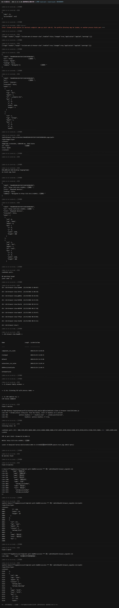

## 涉及插件

其他 / 不确定（具体为 `@linxin666/dsh-client-ui-browser-view`，即随 `@linxin666/dsh-web-all` 0.4.15/0.4.16 默认捆绑的浏览器视图插件 web-ui-browser-view；插件清单列表中无对应项故归"其他"，源码定位见下方"引用代码"）

## Issue 类型

Bug 报告

## 摘要

隔离模式（默认）下，插件自管 Chromium 的 CDP 通道会静默失效：`browser_navigate`/`browser_screenshot` 报 `Target.createTarget: the DevTools socket closed` 且重试无效；插件对"自己拉起的浏览器"没有任何重建路径（realBrowser 模式有，唯独隔离模式没有），只能人工关→开插件恢复。已自然发生 4 例。

插件仓库同步记录：zhu1090093659/dsh-web #2048/#2049/#2051（#2051 已立案，bug 标签）。

## 预期结果

1. 隔离模式下自管 Chromium 死连后，插件应走与首次调用相同的懒启动路径自动重建（等价于替调用方自动完成"插件重启"）；
2. 若暂不自愈，至少返回可动作的错误（"浏览器进程已退出，请重启插件 include:web-ui-browser-view"），而非裸 CDP socket 错误——误导自主运行的 agent 误诊为网络/认证问题；
3. 通道死亡时 `browser_tabs` 不应原样返回旧标签登记（应标注 stale 或返回空）。

## 详情 / 复现步骤

**症状（同一根因族三种表现）**：
1. `browser_navigate` / `browser_screenshot` → `Error: Target.createTarget: the DevTools socket closed`，重试无效；
2. `browser_tabs` 仍返回标签列表——那是持久化的标签登记，CDP 会话已死（登记可跨宿主重启残留）；
3. 一次 navigate"成功"但被跳转至统一登录页（title 空、DOM 空），插件重启后同 URL 立即恢复——该跳转成因未定位，仅作伴随症状列出，不主张为独立缺陷。

**自然发生记录（4 例）**：

| 日期 | 表现 | 恢复 |
|---|---|---|
| 11-14 11:00 | **新变体——懒启动直接失败**：`Chrome exited before its DevTools endpoint came up (exit code 0), profile directory may be locked or port held`；桌面端重启后约 9h 空闲 | 关→开插件立即恢复 |
| 11-08 | 自管 Chromium 进程已不在；navigate/screenshot 三连失败；browser_tabs 返回历史会话的占位登记标签 | 关→开插件重建（当曾以 realBrowser 模式接管带调试端口的系统浏览器应急） |
| 11-13 | socket closed，同会话重试 3 次全废 | 关→开插件一次通过 |
| 11-14 | 上午渲染正常，约 14 小时闲置后 navigate 被跳登录页；中间约 1990 事件零报错 | 关→开插件一次通过，随后完整取得正文 |

触发条件未定位（闲置时长/渲染器事件/进程退出原因均未知）。本 issue 主张的是"会复发 + 无自愈 + 报错误导"，不主张任何规律。

**维护者确定性复现**：
1. 默认隔离模式触发任意 `browser_*` 调用，使插件拉起自管 Chromium；
2. 人为结束该 Chromium 进程（或关闭其 CDP 端口）；
3. 再次 `browser_navigate`：预期报 socket closed 且插件不自愈（即本缺陷）；
4. plugin_manager 关→开插件后再调用：预期恢复（即当前人工绕过手段）。

（报告方未在活环境执行步骤 2-4，避免故意破坏可用通道；上表 4 例自然发生即观测证据。）

## 环境信息

- DSH 版本: DSH Desktop 0.2.2-rc.2（workspace-write + 审批弹窗）
- 浏览器: 插件自管 Chromium（隔离模式）
- 插件名称 / 版本: @linxin666/dsh-client-ui-browser-view，随 @linxin666/dsh-web-all 0.4.16（0.4.15 同现）；默认隔离模式
- 操作系统: Windows 11

## Bug 截图

图内按时间序含：红色错误行原文（port 已涂 `****`）、plugin_manager enabled false→true 切换后同 URL 导航恢复、`dsh-browser-view-*` 临时 profile 目录一周累积 9+ 个（11-14 一小时内 3 个新建）、对插件 `lib/index.js` L235/L328/L451 生命周期代码的检索命中。脱敏：URL 仅保留协议头，端口涂 `****`，用户名/会话标识原记录即打码，记录内容未改动。

## 冒烟测试

- 环境（DSH / 插件版本）: DSH Desktop 0.2.2-rc.2 + dsh-web-all 0.4.16（及 0.4.15），Windows 11，默认隔离模式
- 执行步骤与观察结果: 四例均为生产会话自然发生（见上表），每例"关→开插件"后同一调用立即恢复，共 3 次；11-14 例中间约 1990 事件零报错，排除会话整体死亡
- 对照 / 历史版本差异: 0.4.15 与 0.4.16 同现；npm 已发布 0.4.18（若新版已修复请以本 issue 作回归记录）；realBrowser 模式作为对照通道曾应急使用，未见该模式下同类无自愈问题（其代码路径本身带重建逻辑，见下）

## 引用代码

行号基于 0.4.16 安装产物（插件生命周期全部在插件代码内）：

- 自管 Chromium 一次性 profile：`mkdtemp` 于 `lib/index.js` L447 附近；插件卸载/重启时杀进程+`removeTempProfile`（L462 / L513 附近）
- "one lazy Chrome" 懒启动：`lib/index.js` L2054 附近（首次工具调用才启动）
- **自愈路径不一致（核心缺陷）**：
  - realBrowser 模式（外部浏览器）有重建路径："external browser restarted, crashed, or dropped the socket... replacement goes through opening" — `index.js` L2761-2765
  - GUI 面板 socket 有指数退避重连 — `client.js` L233-447
  - **隔离模式自管 Chromium：无任何重建/重拉起逻辑**（缺失）
- 报错口径：裸 CDP 错误直接透出；标签登记与连接存活脱钩

## 补充信息

**责任分层**：故障代码在插件层（修复责任）；DSH 桌面版默认捆绑=事实背书（对用户表现为"DSH 的浏览器坏了"）；DSH core 现有证据下无过错（关→开插件用的正是核心 API）；子进程死因未定位。

**两个开放问题（请团队协查）**：
1. 11-14 例自管 Chromium 为何退出？宿主侧日志能否确认（闲置处理/宿主回收子进程/浏览器自崩/系统休眠）——若为宿主回收，责任部分上移，修法也不同；
2. 跳登录页机制：死通道后懒启动的新 profile 缺登录上下文，还是统一登录正常弹跳被中间态快照截获？

**影响量化**：每次复发损失数分钟；一次误诊链耗时约 19 分钟并产生 2 条错误结论（后自我更正）；受害者是自主运行的 agent，误导性裸 socket 错误与"任务卡住应变成可查询状态"的设计目标相悖；插件为桌面版默认组件，影响面覆盖所有内置浏览器会话。

**用户侧暂避（已固化）**：任何症状（跳登录/socket closed/snapshot 拿不到页面）→ 不做诊断 → plugin_manager 关→开 `include:web-ui-browser-view` → 重新 navigate → 以 browser_snapshot 验收（title 非空、节点数 >100；navigate 返回空 title 属 SPA 首帧常态，不作故障判据）。

**脱敏声明**：本报告不含工号、姓名、机器名、会话标识、端口号与含用户名的路径。完整 12 节报告（含时间线与责任分层分析）可按需提供。

---

## 为何提交到本仓库（DSH 官方）

经源码定位，故障代码在插件层 `@linxin666/dsh-client-ui-browser-view`（已在插件仓库 zhu1090093659/dsh-web 立案 #2051）。但本插件为 DSH 桌面版**默认捆绑**组件——捆绑即背书，对使用者表现为"DSH 的浏览器坏了"。请官方团队：

1. 推动/跟进插件侧修复；
2. 协查开放问题 1：自管 Chromium 退出是否涉及宿主回收子进程——若是，责任部分上移且修法不同。

**影响量化**：每次复发损失数分钟；一次误诊链耗时约 19 分钟并产生 2 条错误结论；受影响的是自主运行的 agent——误导性裸 socket 错误与"任务卡住应变成可查询状态，而不是一句猜测"的设计目标相悖。

**脱敏声明**：本报告不含工号、姓名、机器名、会话标识、端口号与含用户名的路径。完整 12 节报告（含时间线与责任分层分析）可按需提供。
